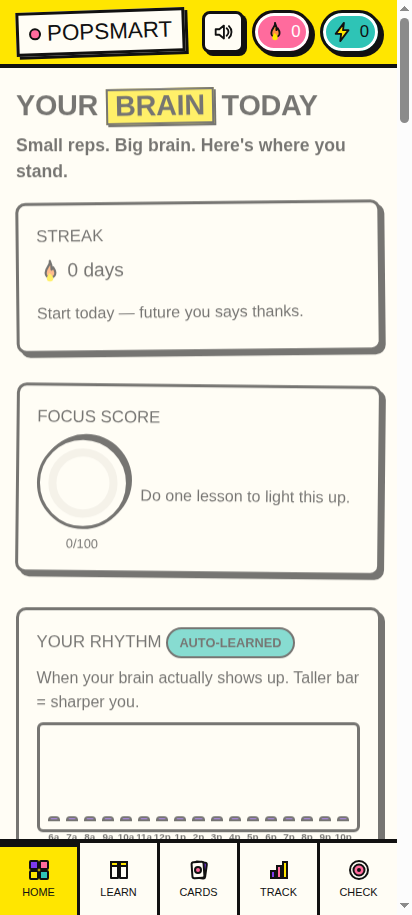
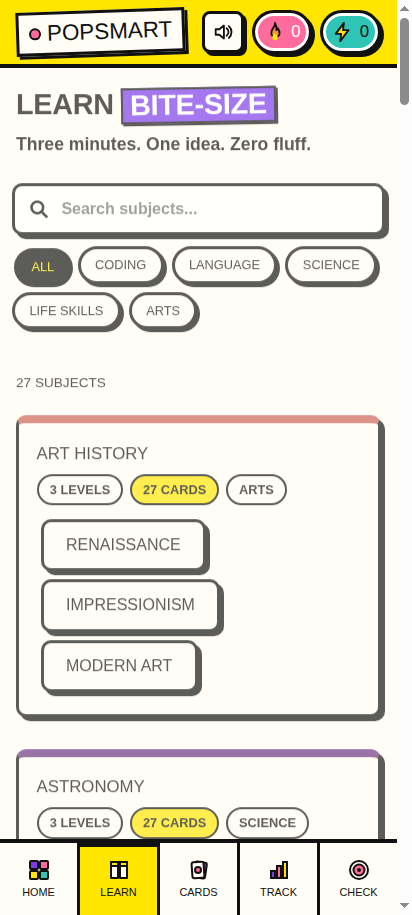
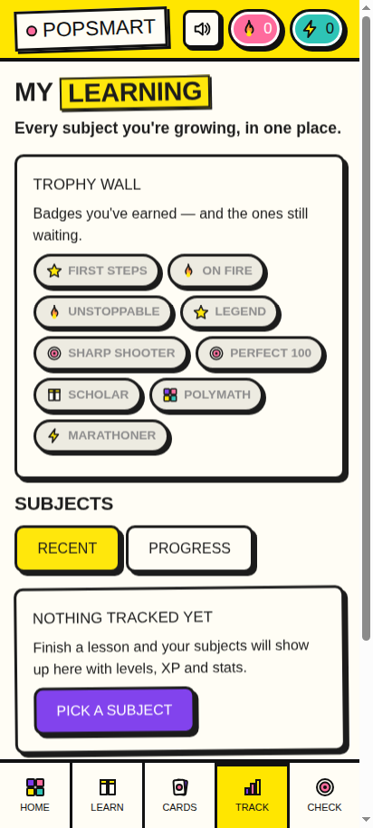

# 🧠 POPSMART


**Bite-size learning that adapts to you.** A free, open-source micro-learning companion — 27 subjects, smart flashcards, and an engine that learns how *you* learn. Web + Android.

✦ VN ✦ — a Vivek Nair original.


*↑ Your brain today: streak, focus score, and your personal rhythm chart.*

## What it does

- **27 subjects** — coding, Spanish, French, Hindi, physics, chemistry, cooking, music theory, personal finance, first aid, chess, and more. 410 lesson cards, 320 flashcards, 400 quiz questions.
- **Bite-size lessons** — 2-minute cards: read, pro tips, examples, quick checks. Three minutes, one idea, zero fluff.
- **Smart flashcards** — SM-2 spaced repetition brings cards back right before you forget them.
- **Skill checkpoints** — quizzes gate each level. Pass at 70%+ to unlock the next.
- **Adaptive engine** — tracks your accuracy, pace, and study rhythm. Tells you your sharpest hour and ideal session length.
- **Learning tracker** — every subject's level, XP, accuracy, and streaks in one place, sortable by recent or progress.
- **Badges** — 9 milestones (3-day streak, perfect 100, Polymath…) with confetti celebrations.
- **Share** — post achievements to socials or copy the text.
- **Dopamine sounds** — procedural chimes, fanfares, and pops for wins. Mutable, obviously.
- **Search + filters** — find anything in the catalog instantly, by name or category.
- **Zero accounts, zero servers, zero telemetry.** Everything lives in your browser's local storage. Nothing leaves your device. Ever.


*↑ Browse 27 subjects — search live, filter by Coding, Language, Science, Life Skills, or Arts.*


*↑ My Learning: trophy wall, per-subject stats, XP bars.*

## 📱 Android app

**[⬇️ Download popsmart-v1.0.apk](releases/download/v1.0/popsmart-v1.0.apk)**

Sideload the APK on your phone — same app, wrapped native. No Play Store needed.

> **Heads up:** it's signed with a self-signed certificate (standard for sideloading). Your phone will ask you to allow "install from unknown sources" — that's normal for APKs outside the Play Store.

## Honest capabilities — read this first

| Capability | Status |
|---|---|
| Works offline | ✅ Yes — everything is bundled, no network needed after install |
| Your progress syncs across devices | ❌ **No.** Progress lives in local storage on each device. No accounts, no cloud. |
| New subjects | ✅ The content packs are plain JSON in `data/` — add your own |
| iOS app | ❌ Not built. The web version runs fine in Safari though. |

**Beta notes:** this is v1.0 — a real, working app that passed automated QA (lesson flows, badge engine, sound system, all 27 content packs validated). If you find a bug, [open an issue](https://github.com/vivekn4/popsmart/issues).

## Run the web version

No build step, no dependencies. Open `index.html` — or serve the folder:

```bash
npx serve .
# or
python3 -m http.server
```

## Tech

Vanilla HTML/CSS/JS. Zero dependencies, zero network requests. ~120KB web, ~250KB APK.

- `index.html` — app shell, routes, SVG icon sprite
- `css/style.css` — neo-brutalist design system
- `js/app.js` — router, store, shell
- `js/engine.js` — learning engine (lessons, SM-2, checkpoints, adaptive stats)
- `js/views.js` — view renderers
- `js/rewards.js` — badges, celebrations, sharing
- `js/sound.js` — procedural WebAudio effects
- `data/pack-*.json` — 27 content packs (also bundled in `data/packs.js` for `file://` use)
- `android/` — WebView wrapper source for the APK build

## License

MIT — learn freely.
